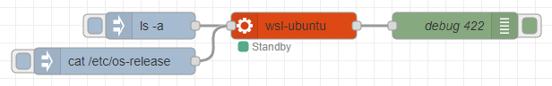
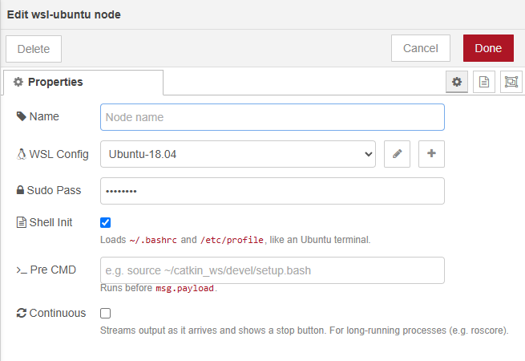
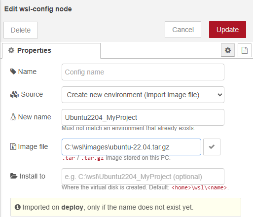
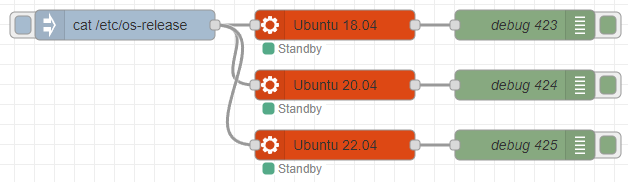
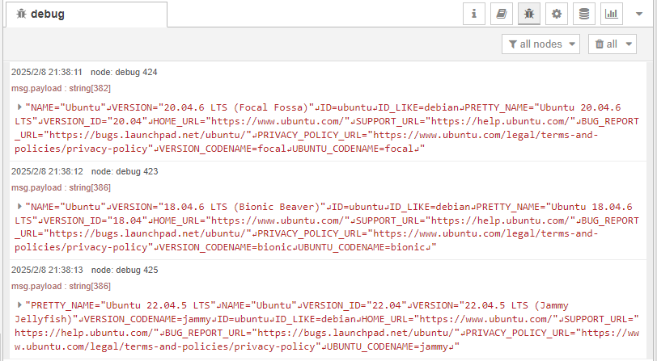
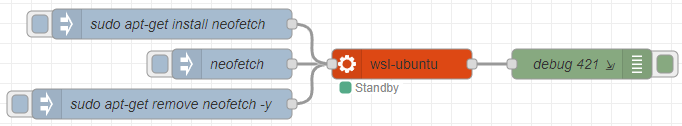
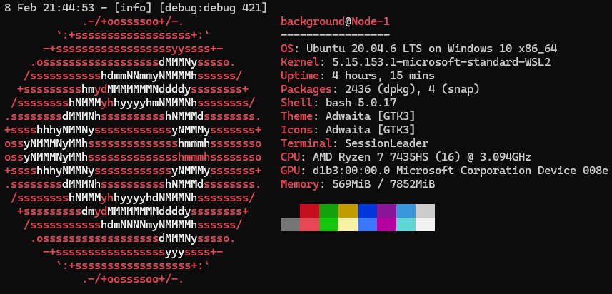

# node-red-contrib-wsl-ubuntu
Node for using Ubuntu environment in WSL with Node-RED

## Overview

This node can execute commands in the WSL Ubuntu environment.



Therefore, **this node works only on Windows**.  
Install the distribution with the `wsl` command in advance, or let the
[configuration node](#configuration-node-using-multiple-environments) import one from a
`.tar` / `.tar.gz` image.  

The node can be set to the following options.  
- The WSL environment to run in (WSL Config node)
- The password used when executing sudo (credential property)
- Whether the shell startup files are loaded (Shell Init)
- A command to run before `msg.payload` (Pre CMD)
- Whether the execution results are output sequentially or not (Continuous)



## Shell Initialization

Commands run in a **login interactive shell**, so `/etc/profile` and `~/.bashrc` are
sourced exactly as they are when you open an Ubuntu terminal. Anything you appended to
`~/.bashrc` (for example `source /opt/ros/humble/setup.bash`) is therefore already in
effect, and environment variables such as `$ROS_DISTRO` resolve as expected.

This matters because Ubuntu's `~/.bashrc` returns immediately when the shell is not
interactive, so a plain non-interactive shell would silently skip all of it.

The behaviour is controlled by the **Shell Init** option, which is enabled by default.
The login banner (MOTD) is suppressed so that it never appears in the output. Disable the
option only if your `~/.bashrc` misbehaves when run this way; the node then falls back to
a non-interactive login shell.

The **Pre CMD** option is still available for commands that should run after the shell
startup files but before `msg.payload`, such as sourcing a workspace `devel/setup.bash`.

## What the Node Runs Internally

Knowing the exact command the node builds makes it much easier to reproduce a problem by
hand in a terminal.

### Starting a command

`wsl.exe` is spawned directly (no `cmd.exe` is involved):

```
wsl.exe -d <distro> --cd ~ -e bash -c "<wrapper command>"
```

| Part | Purpose |
| --- | --- |
| `-d <distro>` | The distribution selected in the WSL Config node |
| `--cd ~` | Start in the Linux home directory, not in the Node-RED working directory |
| `-e bash -c` | Run the wrapper without allocating a terminal |

There is no terminal attached: stdin is closed, and stdout / stderr are piped back to the
node. stdout becomes `msg.payload`, and stderr is reported with `node.error()` unless
"Continuous" mode is enabled.

The wrapper command that `bash -c` receives is:

```sh
env MOTD_SHOWN=1 bash +H -l -i -c '<Pre CMD> && <msg.payload>'
```

| Part | Purpose |
| --- | --- |
| `env MOTD_SHOWN=1` | Suppresses the daily "Welcome to Ubuntu" banner, which `/etc/profile.d/update-motd.sh` would otherwise print into the output |
| `-l` | Login shell, so `/etc/profile` and `/etc/profile.d/*.sh` are read |
| `-i` | Interactive shell, so `~/.bashrc` runs to the end instead of returning at its non-interactive guard |
| `+H` | Disables history expansion, which an interactive shell would otherwise apply to `!` inside a command |
| `'...'` | The command is single-quoted so that `$VAR`, backticks and quotes are expanded by this shell (which has the profile loaded), not by the outer wrapper shell |

`<Pre CMD> && ` is omitted when the Pre CMD field is empty. If "Shell Init" is disabled,
the inner shell is `bash -l -c '...'` instead, and `MOTD_SHOWN` and `+H` are not used.

The shell startup files are therefore read in the usual order:
`/etc/profile` → `/etc/profile.d/*.sh` → `~/.profile` → `~/.bashrc` (Ubuntu's `~/.profile`
sources `~/.bashrc` for bash).

### Commands starting with `sudo`

If `msg.payload` starts with `sudo` and a Sudo Pass credential is set, the password is fed
to `sudo -S` through a pipe and the leading `sudo` is removed from the command:

```sh
echo '<sudo password>' | sudo -S env MOTD_SHOWN=1 bash +H -l -i -c '<Pre CMD> && <rest of msg.payload>'
```

The shell therefore runs as root and reads root's startup files rather than yours. The
`[sudo] password for ...` prompt that `sudo -S` writes to stderr is filtered out of the
output. Note that the password appears in the command line of the wrapper process, so it is
briefly visible to `ps` inside the distribution.

### Stopping a command

Pressing the Stop button, sending `msg.kill=true`, or redeploying the flow runs a cleanup
sequence. On the Windows side the `wsl.exe` process is signalled `SIGINT` → `SIGTERM` →
`SIGKILL`, followed by:

```
taskkill /F /T /PID <pid of wsl.exe>
```

Killing `wsl.exe` does not necessarily stop the Linux process it started, so the node also
looks the process up inside the distribution and terminates it there:

```sh
ps -ef | grep -v grep | grep -F '<msg.payload>' | awk '{print $2}'   # the command itself
ps -ef | grep -v grep | awk '$3 == <pid> {print $2}'                 # its child processes
kill -TERM <pids>                                                    # then, after 1s:
kill -KILL <pids>
```

On redeploy, one final sweep runs so that nothing is left behind:

```sh
pgrep -f '<msg.payload>' | xargs -r kill -9
```

## Continuous Mode

When "Continuous" mode is enabled, command output is sent continuously as it becomes available. This is especially useful for long-running processes like `roscore` or other server applications.

In this mode:
- Output is streamed in real-time 
- A stop button appears in the node allowing you to terminate the process
- You can also terminate the process by sending a message with `msg.kill=true`

When "Continuous" mode is disabled, command output is sent as a single message after the command completes execution.

## Configuration Node (Using Multiple Environments)

The **wsl-config** configuration node selects which Ubuntu environment a `wsl-ubuntu` node runs against.

In the `wsl-ubuntu` node, choose a **WSL Config** to pick the target environment. Each config node represents one environment, so you can keep multiple independent Ubuntu environments (for example one per project) side by side.

### Choosing an environment

When a config node is created, you choose a **Source**:

- **Use existing environment** – pick one of the environments already installed on this PC from a dropdown. The list is read with `wsl -l -v` and can be reloaded with the refresh button. The environment is only used; deploying never modifies or removes it.
- **Create new environment (import image file)** – create a new environment from a `.tar` / `.tar.gz` image stored on this PC (`wsl --import <new name> <install location> <file>`).

### Creating a new environment



- **New name** – the name of the environment to create. It must not match an environment that already exists; the editor rejects a duplicate name and the node refuses to deploy until it is unique. Use letters, digits, dot, dash and underscore.
- **Image file** – path to the `.tar` / `.tar.gz` image on this PC. The check button next to the field verifies that the path exists before you deploy.
- **Install to** – folder where the WSL environment (virtual disk) is created. Defaults to `<home>\wsl\<name>` if empty. The folder is created automatically.

The import runs when the flow is **deployed**, and only if no environment with that name exists yet. While it runs, `wsl-ubuntu` nodes using the config show **Importing...** as their node status and reject commands until the environment is ready. To build another environment, add another config node.

### Reusing an environment after a reinstall

Before importing anything, the configured name is looked up among the installed environments. If it already exists, that environment is used as it is and **no import runs**.

This means that reinstalling this module, or importing the flow on a PC that already holds the environment, picks the existing environment back up instead of recreating it — the data inside it is preserved.

### Removing an environment

This module never removes a WSL environment. Deleting a config node only drops the reference to it, and there is no unregister button and no delete-on-deploy option, so removing a config node, re-importing the flow, or reinstalling the module cannot destroy your data.

Removing an environment is left to you, from a terminal:

```
wsl --unregister <name>
```

Delete the installation folder afterwards if you want the disk space back.

## Usage Examples

Different versions are shown for different Ubuntu environments.





You can also use apt-get to install and remove packages.  
For example, you can output the result of neofetch to System Console.  




